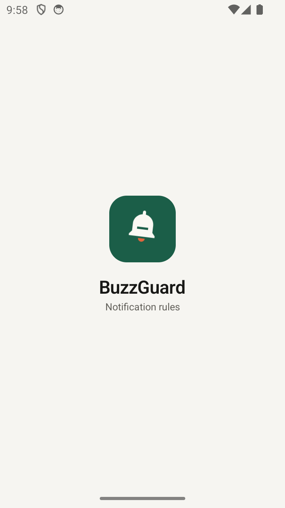
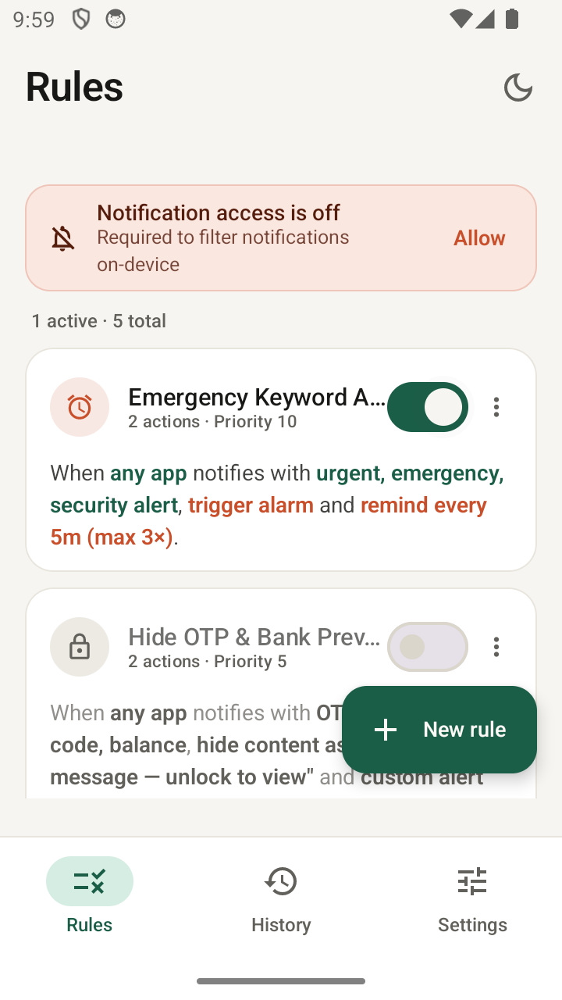
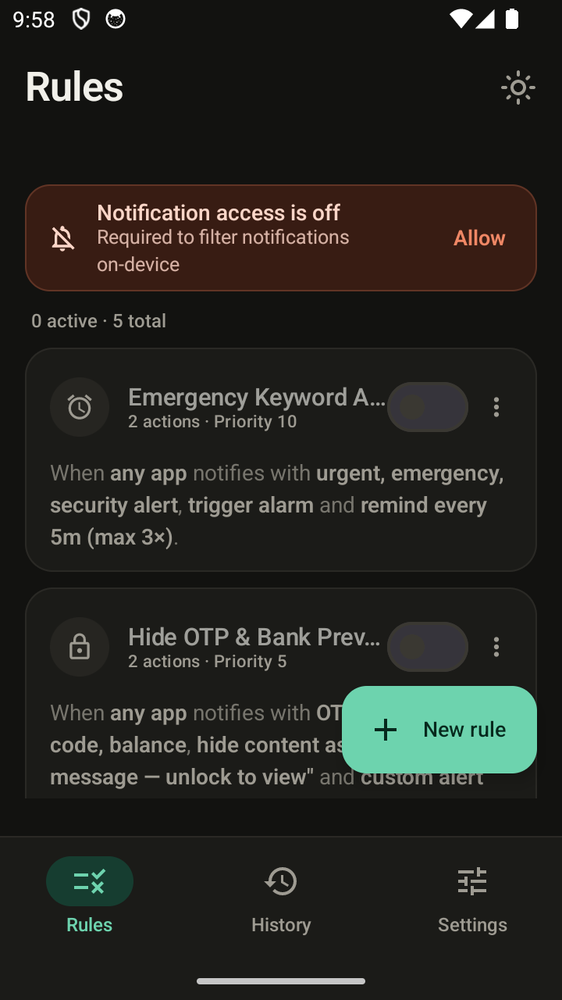
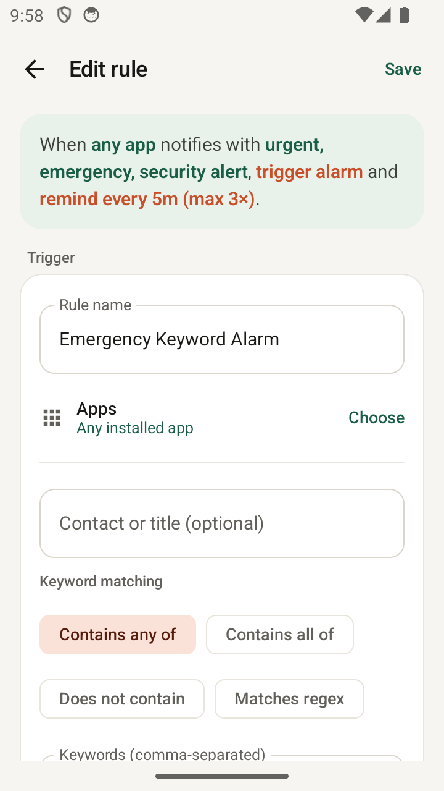
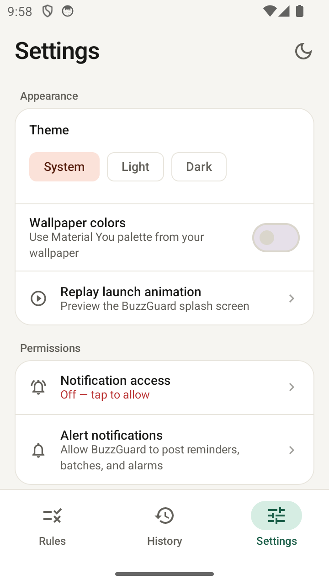

<p align="center">
  
</p>

<h1 align="center">BuzzGuard</h1>

<p align="center">
  <strong>Offline-first notification rule manager for Android</strong> — built with Kotlin, Jetpack Compose, and Material 3.
</p>

<p align="center">
  <a href="https://buzzguard-app.vercel.app"><strong>Live Landing Page &amp; APK Download ↗</strong></a>
</p>

---

## Screenshots

<table>
  <tr>
    <td align="center"><br /><sub><b>Launch Splash</b></sub></td>
    <td align="center"><br /><sub><b>Rules · Light</b></sub></td>
    <td align="center"><br /><sub><b>Rules · Dark</b></sub></td>
    <td align="center"><br /><sub><b>Rule Builder</b></sub></td>
    <td align="center"><br /><sub><b>Settings</b></sub></td>
  </tr>
</table>

---

## Features

### 1. Conditional Rule Engine ("If This, Then That")
- **App Filter:** Match notifications from any app or specific installed apps via a searchable multi-select app picker.
- **Contact / Sender Filter:** Target specific contacts or group chats by notification title.
- **Keyword & Pattern Matching:** `Contains any of`, `Contains all of`, `Does not contain`, `Matches regex`, plus optional **Exclude keywords**.
- **Schedule Window & Days of Week:** Restrict rules to active hours (including overnight ranges like `22:00–07:00`) and specific days (`Sun–Sat`).
- **Device Context Triggers:** Filter by **Screen Off**, **Wi-Fi Connected**, and **Ringer Mode** (`Any`, `Sound on`, `Silent / Vibrate`).
- **Automatic Conflict Resolution:** Ranks matching rules by **manual priority + criteria specificity** so specific rules always beat broad catch-all rules.
- **Plain-English Rule Sentences:** Every rule is displayed with highlighted dynamic tokens instead of cluttered forms.

### 2. Multi-Tool Actions (Combine Multiple Actions per Rule)
- **Cooldown:** Lets the first notification chime, then silences repeated bursts from the same chat for a configurable window (`10s–300s`).
- **Dismiss:** Auto-swipes unwanted/promotional notifications immediately or after a delay (`0s–60s`) without blocking the entire app.
- **Snooze / Batch:** Holds noisy alerts and delivers them together on schedule (`5–120m`) with a live snoozed banner and 1-tap **Deliver now** button.
- **Custom Alert:** Plays custom vibration patterns (`Gentle`, `Double Tap`, `Heartbeat`, `Rapid`, `SOS`) and optional sound for VIP contacts or keywords.
- **Remind Me:** Re-alerts on an interval (`1–30m`, up to `8×`) until the notification is opened or cleared.
- **Alarm:** Loops on the Android alarm audio channel + SOS vibration with a **Stop Alarm** notification button.
- **Auto-Reply:** Replies automatically via Android `RemoteInput` if a message goes unseen past your configured delay (`0s–120s`).
- **Secret:** Cancels sensitive alerts (OTPs, banking) and replaces them with a lock-screen-safe redacted placeholder.

### 3. Notification History, Undo & Quick Rule Creation
- **Local Searchable History:** Stores up to 500 recent notifications in an on-device SQLite database (`buzzguard.db`), searchable by app, title, body, or matched rule.
- **Undo Swipe Prompt & Restore:** Shows a silent 6-second **Undo** action when you accidentally swipe away a notification, plus 1-tap restore from History.
- **Create Rule from History:** Tap any logged notification to inspect details and create a pre-filled rule in one tap.

### 4. Design, Backup & Strict Offline Privacy
- **Light, Dark & Material You:** Warm Stone light theme, Warm Carbon dark theme, System default, 1-tap top-bar toggle, and optional Android 12+ wallpaper dynamic colors.
- **Offline JSON Backup & Restore:** Export and import rules locally via Android's document picker.
- **Live Notification Simulator:** Test enabled rules directly inside Settings without waiting for external notifications.
- **Zero `INTERNET` Permission:** `AndroidManifest.xml` does **not** request `android.permission.INTERNET` — zero ads, zero trackers, zero cloud sync.

---

## Project Structure

```text
buzzguard/
├── app/src/main/java/com/buzzguard/app/
│   ├── BuzzGuardApp.kt                        # Singleton container
│   ├── MainActivity.kt                        # Edge-to-edge Compose root, splash & navigation
│   ├── model/Models.kt                        # Rules, actions, context filters, vibration presets
│   ├── engine/RuleEngine.kt                   # Pure Kotlin rule matcher, conflict resolution, cooldowns
│   ├── data/
│   │   ├── BuzzGuardDatabase.kt               # Local SQLiteOpenHelper storage + JSON export/import
│   │   └── BuzzGuardRepository.kt             # StateFlows, starter templates, installed apps query
│   ├── service/
│   │   ├── ActionExecutor.kt                  # Notification channels, alarm, batch, reminders, RemoteInput
│   │   ├── BuzzGuardActionReceiver.kt         # BroadcastReceiver for Stop Alarm & Undo Swipe actions
│   │   └── BuzzGuardNotificationListener.kt   # NotificationListenerService + device context reader
│   └── ui/
│       ├── theme/Theme.kt                     # Warm Stone Light, Warm Carbon Dark & Material You
│       ├── Components.kt                      # Highlighted rule sentences & shared surfaces
│       ├── SplashScreen.kt                    # Tactile animated launch screen
│       ├── BuzzGuardViewModel.kt              # DataStore preferences, rule CRUD & simulator
│       ├── RulesScreen.kt                     # Sentence-first rule cards & quick actions
│       ├── RuleEditorScreen.kt                # Interactive multi-tool rule builder & app picker
│       ├── HistoryScreen.kt                   # Notification-shade style history & Undo
│       └── SettingsScreen.kt                  # Grouped settings, theme, backup & rule tester
├── docs/screenshots/                          # App screenshots used in README
└── landing/                                   # Static landing page deployed to Vercel
```

---

## Build & Test

```bash
# Run unit tests (RuleEngineTest) and build Debug APK
./gradlew testDebugUnitTest assembleDebug
```

Debug APK output: `app/build/outputs/apk/debug/app-debug.apk`
